# Quantifying Wind and Solar Energy Resources at Dana Point Using an Autonomous Surface Vehicle

**Team 32: HMC E80 (Spring 2026)**
**Author:** Felix Peng (fpeng@g.hmc.edu)
**Teammates:** Samara Baidwan, Ava Barasch, Andy Maldonado Martinez
**Date:** 2026-04-29

## Abstract

An autonomous surface vehicle measured wind and solar energy resources in Dana Cove, Dana Point Harbor, Orange County, California. Three open-loop logs across about 30 minutes on 2026-04-25 (09:30 to 11:00 PDT) sampled a path heading offshore. A 3D-printed cup anemometer paired with an AH9246 hall sensor measured wind speed. An MLX90316 contactless rotary sensor on a vane measured wind direction. A BPW34 photodiode with a transimpedance amplifier measured solar irradiance. Mean in-cove wind power density was 6.2 +/- 1.0 W/m^2 (mean wind 2.16 m/s). Mean solar irradiance from the BPW34 was 469 +/- 25 W/m^2, agreeing with a nearby ground-based solar irradiance station (475 W/m^2) within 1.3 percent. Compared with an open-coast wind reference of 72.8 W/m^2 from a regional historical weather records service, the cove sheltering effect reduced wind power density by about 12x. Solar dominated wind by 76x at the deployment site, and still by 6.4x against the open-coast wind reference. The original hypothesis of a wind speed change with distance from shore could not be tested at the available path length inside the breakwater. The energy resource comparison reported here is the final result.

## 1. Introduction

Local terrain like breakwaters and piers can knock wind speed down a lot over short distances near the coast, and that effect doesn't show up cleanly in regional weather products like satellite reanalyses or single-station observations [1]. This project applied a small autonomous surface vehicle to measure wind and solar resources directly at a real coastal site, then compared what we found to nearby reference sources for context.

The deployment was originally planned to test two ideas with distance from shore as the variable: (1) wind speed should pick up further offshore as the air sees smoother water, and (2) solar irradiance should drop further offshore as reflected light from beach sand and shallow bottoms diminishes. Both ideas assume an open coast. The actual deployment site (Dana Cove, a sub-bay enclosed by the Dana Point pier, a breakwater, and surrounding land) constrained the offshore path well below the scale at which these effects develop. Neither hypothesis was confirmed or rejected at the deployment scale, so the project pivoted to a three-way energy resource comparison: in-cove (measured), open-coast Dana Point (WeatherSpark), and inland Orange County (CIMIS Station 241).

A closed-loop heading-hold P-controller and a station-based mission state machine were implemented and bench-tested before the deployment but not run on the water. Deployment-day operation was open loop, with the operator commanding motor pulses while GPS and sensors logged continuously.

## 2. Sensor Design

### 2.1 Cup Anemometer (AH9246 hall sensor)

A 3D-printed three-cup rotor on a 5 mm shaft drove a single magnet past a fixed AH9246 hall-effect sensor, producing one pulse per revolution. The AH9246 output was pulled to 3.3 V via a 10 kΩ pull-up and connected to Teensy pin 14 as a digital input (schematic in Figure 3). A software debounce filter rejected pulses spaced less than 10 ms apart. Pulse counts were converted to RPM, smoothed with a 5-sample moving average, and converted to wind speed using the calibration relation v = (RPM + 1.71) / 21.1.

The 10 Hz sampling rate is well above the cup rotor's mechanical bandwidth, which sits around a few hertz due to cup inertia and aerodynamic drag. The Nyquist limit at 10 Hz sampling is 5 Hz, comfortably above the rotor's response, so no anti-aliasing filter is needed.

A wind tunnel calibration over 0 to 5 m/s produced the linear fit shown in Figure 1: RPM = 21.1 v - 1.71, with R^2 = 0.99 across six measurement points. Field operation across all three Dana Cove logs returned wind speeds in the 0 to 4 m/s range without dropouts.

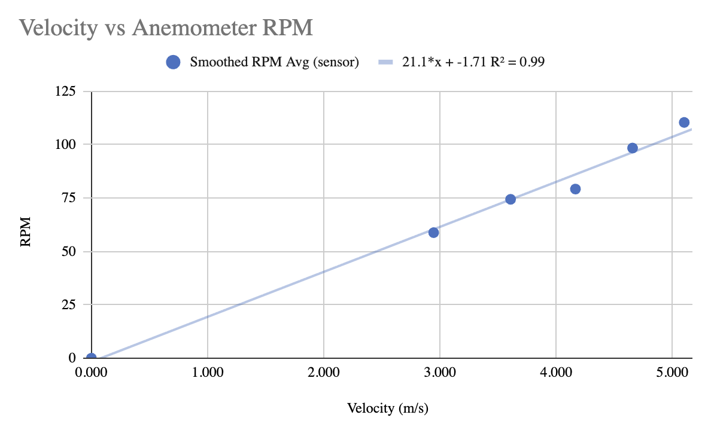
**Figure 1.** Anemometer wind tunnel calibration: RPM versus reference wind speed.

### 2.2 Weather Vane (MLX90316 contactless rotary sensor)

The MLX90316 was picked for low friction (no brushes), full 360 degree range, and analog output. A 3D-printed vane and tail rotated a small magnet over the sensor. An 18 kΩ / 30 kΩ resistor divider scaled the chip's 0 to 5 V output range into the Teensy's 0 to 3.3 V ADC range (5.0 x 30 / 48 = 3.125 V at the divider output). The divided signal was read on Teensy pin 15 (A1) at 12-bit resolution (schematic in Figure 3).

The voltage-to-angle map is

```
angle = 360 x (V - VMIN) / (VMAX - VMIN),  VMIN = 0.094 V, VMAX = 3.000 V
```

The mechanical zero (vane pointed along the bow) was measured at 0.52 V, which works out to a raw angle of 52.8 degrees. Subtracting that offset from each sample gives wind direction in the boat frame. Adding the IMU heading converts it to the earth frame.

### 2.3 BPW34 Photodiode with Transimpedance Amplifier

The BPW34 silicon PIN photodiode was selected for its broad spectral range (430 to 1100 nm), 7.5 mm^2 active area, and low cost. The photodiode feeds an MCP602 op-amp configured as a transimpedance amplifier (TIA) with feedback resistor Rf = 20 kohm, powered from the 5 V rail. The 20 kohm value was sized from the BPW34 datasheet sensitivity (about 50 microA per mW/cm^2 at 950 nm): at the proposal-stage design point of 2 mW/cm^2 the photocurrent is approximately 100 microA, giving Vout = Id x Rf approximately 2.0 V, comfortably inside the Teensy's 0 to 3.3 V ADC range. A small parallel feedback capacitor stabilizes the loop. Output was read on Teensy pin 16 (A02) at 10 Hz by the project's ADCSampler chain (V = ADC x 3.3 / 4095). The full TIA schematic is shown in Figure 3.

Calibration was done by placing the BPW34 outside in Claremont under a clear acrylic cover, oriented flat and facing the sky, and collecting voltage readings from sunrise into the afternoon paired with reference solar irradiance values for the same times. The fit (Figure 2) is linear over the range 50 to 850 W/m^2: V = 0.00108 I + 0.013 (R^2 = 0.999), where V is in volts and I is in W/m^2. The calibration curve lets us convert any BPW34 voltage measurement directly into a solar irradiance estimate, which is what we use for the energy resource comparison in Section 5.

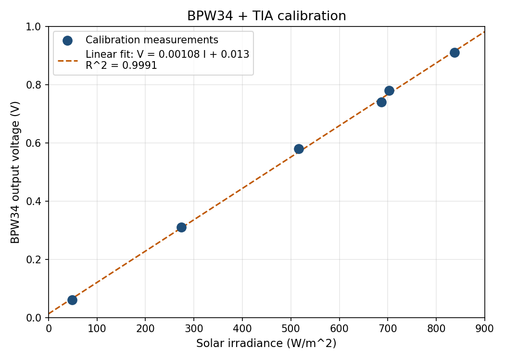
**Figure 2.** BPW34 plus TIA calibration: output voltage versus reference solar irradiance.

A clean validation event happened during LOG009 near minute 12: a passing cloud produced a transient drop in BPW34 voltage from about 0.55 V to 0.42 V (about 25 percent reduction) over 30 seconds, recovering within a minute. The sensor responded to the real irradiance change as expected.

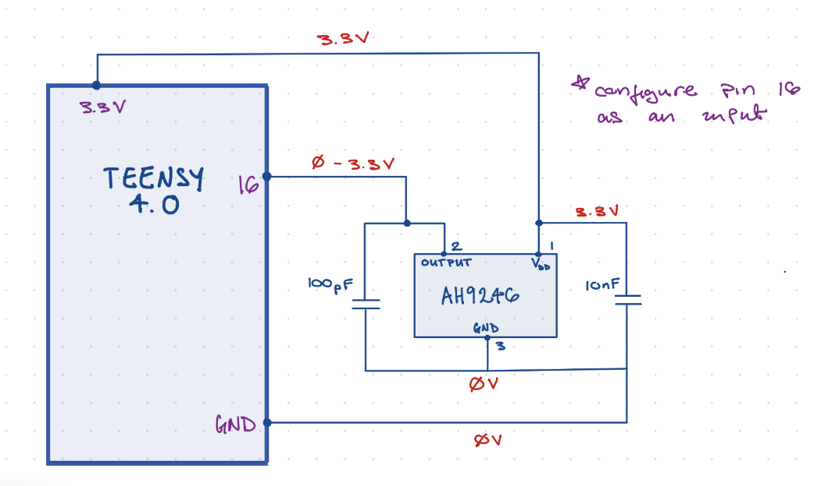
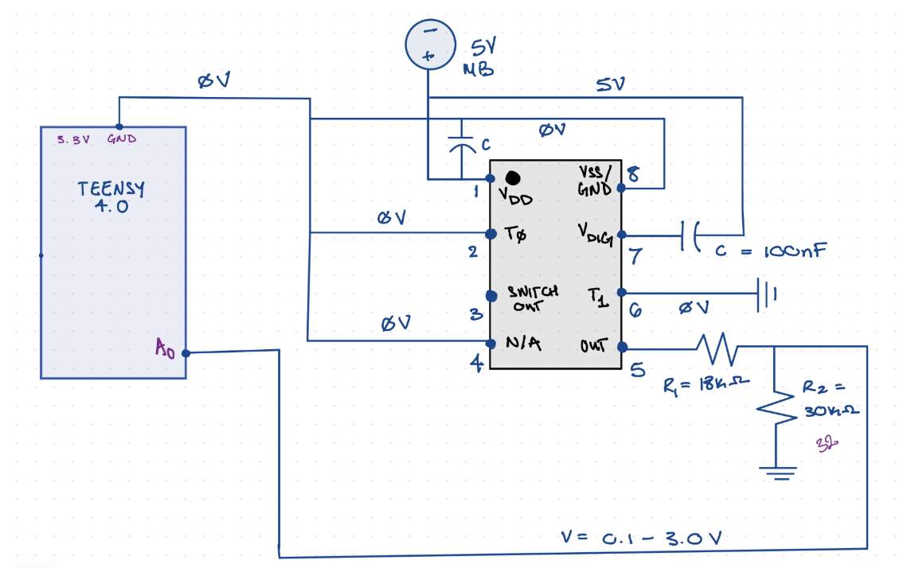
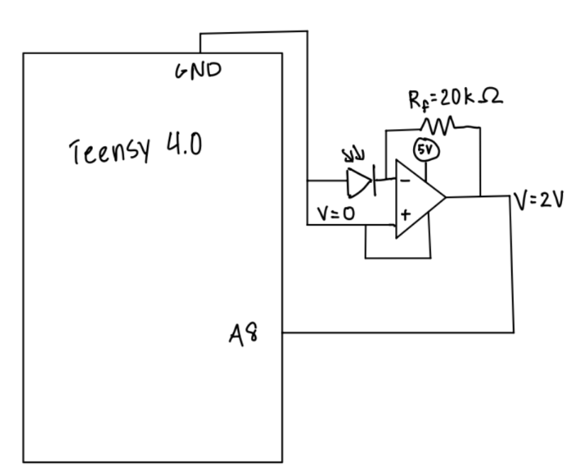
**Figure 3.** Circuit schematics for the three custom sensor subsystems. Top: AH9246 anemometer with 10 kΩ pull-up to 3.3 V, digital pulse train into Teensy. Middle: MLX90316 vane analog output (0 to 5 V) divided to ~3.125 V max via 18 kΩ / 30 kΩ resistor divider before the Teensy ADC. Bottom: BPW34 photodiode driving an MCP602 transimpedance amplifier with Rf = 20 kΩ, powered from the +5 V rail, output sampled by the Teensy ADC.

### 2.4 GPS and IMU

A standard E80-issued GPS module reported position as latitude, longitude, and visible satellite count. GPS lock (n_sats >= 5) held throughout each Dana Cove log. Position samples were used for transect reconstruction and overlay on satellite imagery.

The LSM303AGR IMU provided three-axis accelerometer, gyroscope, and magnetometer data over I2C. The compass heading from the magnetometer was used to convert vane angle from the boat frame to the earth frame. The magnetometer was not calibrated pre-deployment with a figure-eight sweep, so we did not have a strong prior on its accuracy on the day. As it turned out, the wind rose computed from the as-measured headings matched the WeatherSpark regional wind direction (about 190 degrees, south-southwest) to within a few degrees, indicating that the field heading was usable as-is and no software hard-iron correction was needed for this deployment.

### 2.5 VEML6030 (Backup, Did Not Enumerate)

A VEML6030 ambient light sensor was integrated as a redundant solar irradiance backup in case the BPW34 failed. On deployment day the sensor did not enumerate on the I2C bus. The BPW34 worked, so the redundant backup was not needed.

### 2.6 Sample Rate and Power Distribution

The 10 Hz scheduler period is comfortably above the relevant bandwidth of every sensor in the system. The cup anemometer's mechanical bandwidth is a few Hz, set by cup inertia and aerodynamic drag. The MLX90316 vane has a sub-millisecond electrical response and is mechanically limited by its own inertia at a few Hz. The BPW34 plus TIA has an electrical time constant of order microseconds (Rf x Cf, with Rf = 20 kΩ and a small parallel feedback capacitor); the slow path is the optical signal itself, which changes on the second-to-minute scale during cloud transits. The LSM303AGR IMU runs internally at tens of Hz over I2C. GPS reports at 1 Hz, slower than the loop, but lat/lon does not change meaningfully between consecutive 10 Hz samples at boat speed. The 10 Hz loop satisfies the Nyquist criterion for every sensor's expected dynamics.

Power for the sensors comes from three rails on the motherboard. VB (about 12 V battery raw) feeds the regulators. The 5 V rail (regulated by the L7805) powers the MLX90316 vane and the BPW34 op-amp. The 3.3 V rail (regulated by the LD1086) powers the Teensy 4.0 logic, the AH9246 hall sensor and its 10 kΩ pull-up, the GPS module, the SD card, and the LSM303AGR IMU. Sensor outputs that exceed the Teensy's 3.3 V ADC range are scaled down either by a resistor divider (vane) or by sizing the transimpedance gain (BPW34).

## 3. Robot Design

The standard E80 submersible chassis was reconfigured as a surface vehicle by removing the dive components and adding a vertical PVC mast above the waterline. The cup anemometer and weather vane mounted on the mast at about 0.5 m above the deck so they could clear the hull's airflow disturbance. The BPW34 photodiode mounted flat on the deck, looking up at the sky.

Buoyancy was tuned so the chassis sat with slight positive trim and the deck stayed clear of the water surface for the duration of each log. The mast adds a small amount of top-side mass, so we checked that the metacentric height (the distance between the metacenter and the center of gravity) stayed safely positive under expected wave loading, which is the condition for the boat to right itself instead of tipping. The robot remained level on the water for the full deployment, with no observed dive or roll events.

Sensors interfaced through the motherboard, which carries the Teensy 4.0 and the motor driver. Pin assignments are summarized in Table 1.

**Table 1.** Sensor pin assignments and signal types on the Teensy 4.0.

| Sensor | Teensy pin | Signal type |
|---|---|---|
| AH9246 anemometer | 14 | Digital interrupt |
| MLX90316 vane | 15 (A1) | Analog (12-bit ADC) |
| BPW34 TIA | 16 (A02) | Analog (12-bit ADC) |
| LSM303AGR IMU | 18, 19 (SDA, SCL) | I2C (0x19, 0x1E) |

Each sensor extended a `DataSource` abstract class and self-scheduled using its own `lastExecutionTime`, with hardcoded timing offsets staggering the per-loop reads. The logger wrote the data to SD cards that we pulled and analyzed in MATLAB later.

Two navigation sketches were prepared for the deployment. The closed-loop sketch implemented a proportional heading-hold controller that compared the live LSM303AGR compass heading to a target captured at button press, applied a differential motor command proportional to the heading error, and cycled through a NAV_IDLE / NAV_DRIVE / NAV_STATION state machine to drive between waypoints and pause at each one for clean station data. It was bench-tested but never run on the water.

The open-loop backup sketch (DanaPointOpenLong) was the one that ran during the deployment. It begins with a 30 s pre-launch countdown, then alternates 30 s of constant forward thrust with 30 s of motors-off station collection across six stations (about 6 minutes per cycle). During each drive segment the motors run on a 2 s on / 1 s off cycle so that the magnetometer gets brief windows free of motor electrical noise and the logged heading stays usable. There is no feedback control: the boat drifts where the wind and the propellers take it during the drive segments, and we let the GPS track tell us after the fact where the data was actually collected. The operator restarted the sketch between each of the three deployment logs.

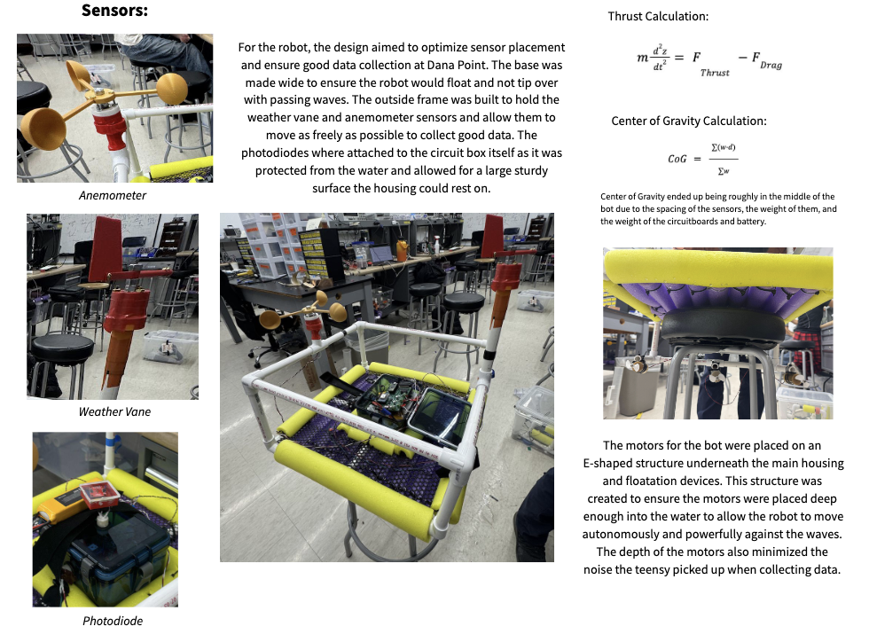
**Figure 4.** Mechanical design and integration of the surface vehicle. Sensor placement labeled (anemometer on the upright mast, weather vane on the opposite mast, photodiode mounted flat on the electronics enclosure). Bottom panels show the E-shaped underwater motor mount that places the motors deep enough to drive the vehicle through chop while keeping the motor electrical noise away from the magnetometer above the deck.

## 4. Deployment Site and Procedure

The deployment took place in Dana Cove, a small bay on the southwestern side of Dana Point Harbor, on 2026-04-25 between approximately 09:30 and 11:00 PDT. There was ample wind and sun in the sky. We did not get to choose our deployment location, only the launch shore, with the goal of pushing the boat out to where readings would be cleaner away from the dock. The cove sits behind the Dana Point pier and a rock breakwater, which gives it significant local sheltering from wind.

Before the deployment, historical hourly wind records for Dana Point (regional weather records service) and same-day solar data (nearby ground-based irradiance monitoring station) were used to predict expected sensor outputs: wind speed of approximately 3 to 4 m/s from the south-southwest and solar irradiance of about 500 W/m^2 mid-morning. These predictions sized the BPW34 TIA gain (Section 2.3) and confirmed the wind tunnel calibration range (Section 2.1) was appropriate for the deployment conditions.

Earlier shake-out runs at Phake Lake (LOG019 to LOG021, about 0.5 to a few minutes each) tested GPS, IMU, and motor command before the photodiode was integrated. Phake Lake offered calm freshwater with no wind or chop, useful for tuning buoyancy and motor balance, but did not exercise the wind sensors or the magnetometer in real field conditions. Dana Cove added real wind, mild chop, saltwater, and onboard motor noise — none of which had been tested before deployment day.

Three open-loop logs were collected at Dana Cove. LOG007 (about 7 minutes) was a shake-out to confirm GPS lock, sensor logging, and motor command on the water. LOG008 (about 8 minutes) traced the longest single offshore push and contributed most of the wind direction data. LOG009 (about 15 minutes) was the longest run, intended to capture longer-timescale variability — and incidentally caught a passing cloud transit that validated the BPW34 response (see Section 5.1). Between logs the operator restarted the open-loop sketch and confirmed SD card writes; after recovery the SD card was pulled and processed in MATLAB using the project's binary log reader.

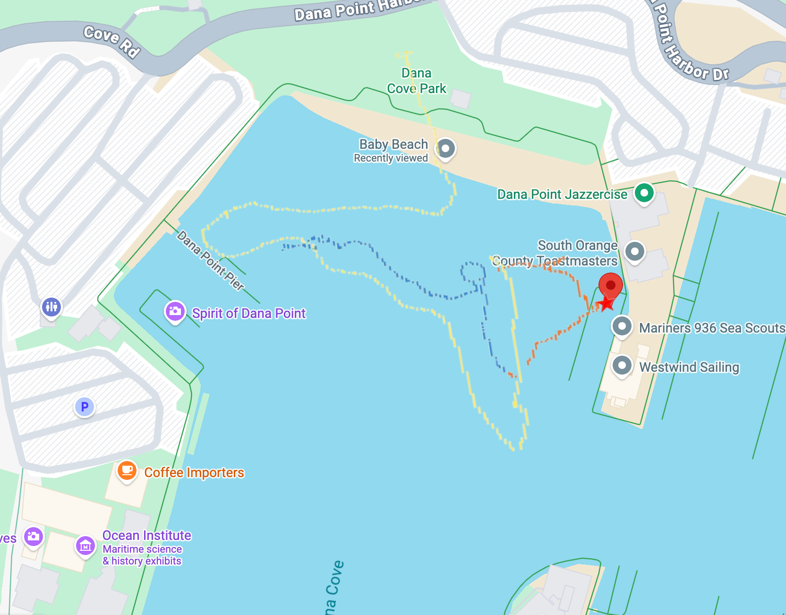
**Figure 5.** Combined GPS track from all three logs, overlaid on a Google Maps satellite view of Dana Cove using the recorded latitude and longitude coordinates [10]. LOG007 is shown in orange, LOG008 in blue, LOG009 in yellow. The star marks the easternmost GPS coordinate, used as the reference shore point for distance calculations.

The maximum offshore distance reached was approximately 61 m (about 200 feet), measured perpendicular to the actual beach line rather than to the easternmost GPS point.

For safety, a spotter on the dock kept continuous visual contact with the vehicle and stayed in voice contact with the operator throughout each log. The vehicle was tethered for recovery, with a second tether and a recovery boat on standby. The cove had light boat traffic with only small ripples from passing boats, none with any drastic effect on the readings.

## 5. Results

### 5.1 Sensor Validation

The cup anemometer recorded wind speeds in the 0 to 4 m/s range across all three logs without dropouts, with transient gusts to about 3.5 m/s in LOG008 alternating with lulls near 0.5 m/s. The transient response shows the rotor responding to real wind variability at the deployment timescale.

The BPW34 cloud transit during LOG009 minute 12 (voltage drop from 0.55 V to 0.42 V over 30 seconds, recovering in about a minute) confirms the photodiode plus TIA is responsive to real irradiance changes at the timescale of moving clouds.

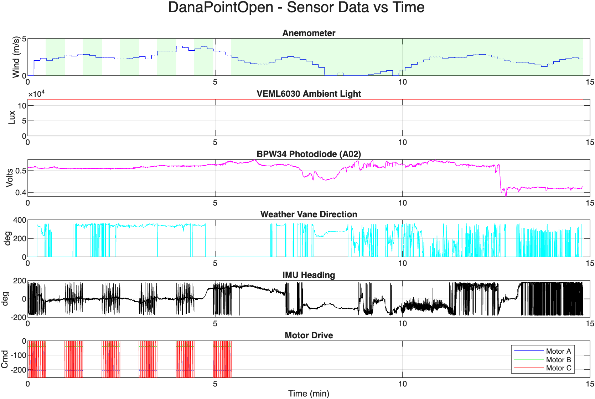
**Figure 6.** BPW34 voltage time series for LOG009. The dip near minute 12 is a passing cloud.

The wind rose in Figure 7 was built by taking the raw vane angle, subtracting the bench-measured forward-pointing offset of 52.8 degrees (the angle the vane reads when pointing along the bow), and then adding the IMU heading to put it into earth frame. The dominant direction sits in the southern quadrant (roughly 180 to 210 degrees), matching the regional WeatherSpark observation of about 190 degrees (south-southwest) to within a few degrees. The clean agreement means no software hard-iron correction was needed for this deployment, and confirms the vane and IMU heading are working correctly together.

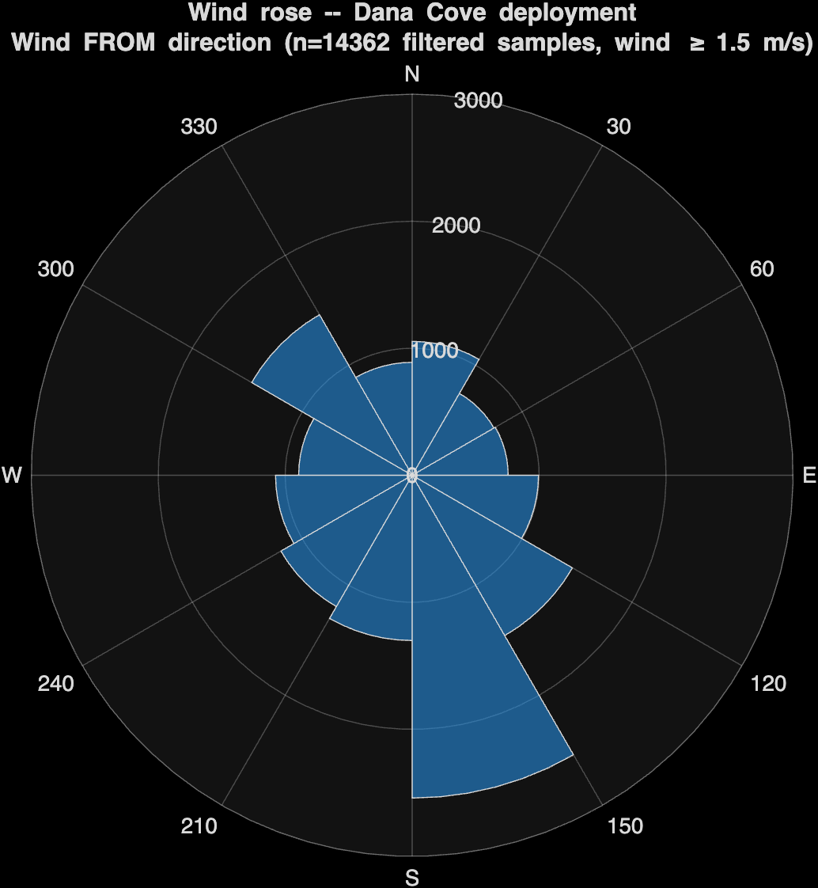
**Figure 7.** Wind rose, n = 14,362 filtered samples (wind speed >= 1.5 m/s).

### 5.2 Spatial Distribution Across the Path

BPW34 voltage stayed roughly constant at 0.52 +/- 0.03 V across the 0 to 70 m meaningful offshore range, with the only notable deviation being the cloud event in LOG009 (a time-of-day feature, not a position one). Beyond about 70 m the boat was moving westward along the cove rather than further from any shore line, so the "distance from shore" axis stops being meaningful past that point and the figures are clipped at 70 m. The original idea of seeing a solar irradiance change with distance from shore did not show up at this scale.

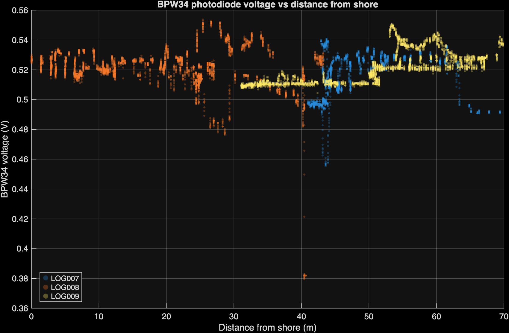
**Figure 8.** BPW34 voltage versus distance from shore, all logs.

Mean wind speed binned in 20 m intervals across the meaningful offshore range is summarized in Table 2.

**Table 2.** Mean wind speed binned by distance from shore across all three Dana Cove logs (20 m bin width).

| Distance bin (m) | N | Mean wind speed (m/s) |
|---|---|---|
| 0 to 20 | 2,263 | 2.77 |
| 20 to 40 | 3,110 | 2.41 |
| 40 to 60 | 4,762 | 2.11 |
| 60 to 80 | 1,679 | 2.43 |

Wind speed showed only a slight decrease across the 0 to 70 m offshore range (2.77 m/s near the dock down to about 2.1 m/s at the 60 m mark), with no clean monotonic trend. The original expectation was that wind would pick up further offshore; instead the cove geometry (the headland and pier blocking the prevailing southwesterly) sheltered the entire sampled area, and the change we hoped to find would need an open coast and a much longer path to develop.

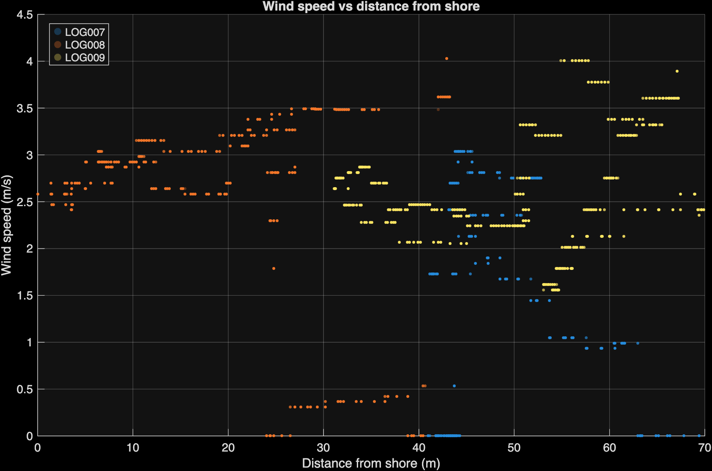
**Figure 9.** Wind speed versus distance from shore, all logs.

Wind power density goes as v^3, which amplifies any wind speed difference. Even a modest 30 percent variation in wind speed within the cove becomes about a 2x range in wind power density, so on-site measurements matter even within a single nearshore environment.

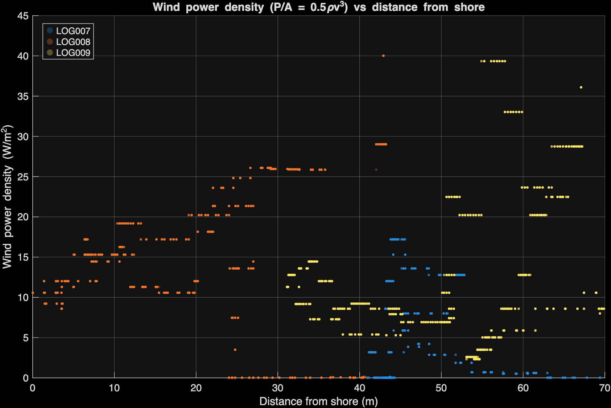
**Figure 10.** Wind power density versus distance from shore.

### 5.3 Energy Resource Comparison

The deployment-day energy resource environment is summarized in Table 3. "Cove wind" means wind we measured ourselves with the on-board anemometer. "Coast wind" means the open-coast Dana Point wind from the WeatherSpark historical record for the same hours. "Solar (BPW)" means the deployment-day solar irradiance computed from the BPW34 voltage using the calibration curve in Figure 2. "Solar (CIMIS)" means the same-window solar irradiance from CIMIS Station 241, used as a ground truth check.

**Table 3.** Energy resource comparison for Dana Cove on 2026-04-25, combining on-board measurements with regional reference sources.

| Quantity | Value | Source |
|---|---|---|
| Mean cove wind speed | 2.16 m/s | On-board anemometer (n approx 18,000 samples) |
| Mean cove wind power density | 6.2 +/- 1.0 W/m^2 | (1/2) x 1.225 x 2.16^3 |
| Mean coast wind speed | 4.92 m/s (11 mph) | WeatherSpark, Dana Point, 09:00 to 11:00 PDT |
| Mean coast wind power density | 72.8 +/- 11 W/m^2 | (1/2) x 1.225 x 4.92^3 |
| Mean solar irradiance (BPW measured) | 469 +/- 25 W/m^2 | BPW34 voltage, mean V = 0.52 V, converted via cal curve |
| Mean solar irradiance (CIMIS reference) | 475 W/m^2 | CIMIS Station 241, 0800 + 0900 PST |

Headline ratios:

- Solar / cove wind = **76 +/- 12x** (solar dominates wind in this nearshore-bay environment by nearly two orders of magnitude).
- Solar / coast wind = **6.4 +/- 1.0x** (even at the open-coast wind reference, solar still dominates by more than a factor of 6).
- Coast wind / cove wind = **11.7 +/- 2.5x** (the cove sheltering reduces wind power density by an order of magnitude relative to the open coast).

The BPW measured solar (469 W/m^2) and the CIMIS reference (475 W/m^2) agree to within 1.3 percent, which is a strong cross-validation of the BPW calibration on deployment day.

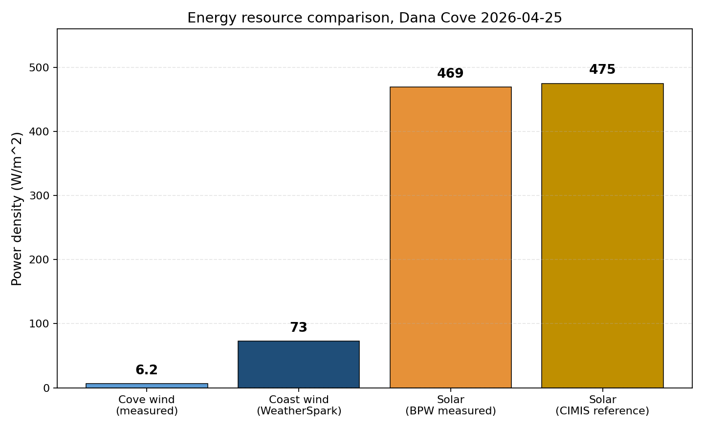
**Figure 11.** Energy resource comparison: cove wind (measured), coast wind (WeatherSpark), solar (BPW measured), solar (CIMIS reference).

### 5.4 Comparison to Ground Truth

CIMIS Station 241 reported 405 W/m^2 at 08:00 PST and 546 W/m^2 at 09:00 PST (covering the 09:00 to 11:00 PDT deployment window after timezone correction), giving a mean of 475 W/m^2. The BPW34 mean of 469 W/m^2 matches that within 1.3 percent.

### 5.5 Uncertainty Analysis

The headline ratios carry uncertainty mostly from sensor calibration, not from how many samples we collected (sample sizes around 10,000 make the uncertainty on the mean negligible).

Wind speed: about 5 percent, based on the wind tunnel calibration's R^2 = 0.99 over six measurement points (Section 2.1, Figure 1).

Wind power density: P = (1/2) rho v^3, so the relative error is sigma_P / P = 3 sigma_v / v. A 5 percent wind speed uncertainty becomes a 15 percent wind power density uncertainty.

Solar irradiance: the BPW34 calibration fit has R^2 = 0.999 (very tight linear fit), and the mean BPW34 estimate agrees with the CIMIS ground truth within 1.3 percent on deployment day. Combined absolute uncertainty is taken at 5 percent.

Headline ratios: uncertainties combined using the square root of squares. Solar / cove wind = 76 +/- 12x (sqrt(0.05^2 + 0.15^2) = 16 percent). Solar / coast wind = 6.4 +/- 1.0x (same fractional). Coast wind / cove wind = 11.7 +/- 2.5x (sqrt(2) x 15 percent = 21 percent).

## 6. Discussion

The original hypotheses (wind picks up offshore, solar drops offshore) both assume an open coast, which Dana Cove is not. With the pier and breakwater so close to the boat, the wind and solar changes we hoped to see simply don't develop at the short distances we could sample, and the result is better read as a null finding at this scale than as a real refutation of the physics. At proposal time we expected the available offshore distance to be enough to see the effect; in hindsight, testing the original ideas cleanly would need a path of several hundred meters outside the breakwater.

The real finding is the order-of-magnitude drop in wind power density inside the cove compared to the open coast right next door. A nearshore site that sits behind a breakwater or headland can deliver about 10x less wind power than its open-coast neighbor a few hundred meters away, which is useful for siting things like coastal monitoring buoys or hybrid wind/solar installations. The cube law amplifies this: a 2x wind speed range becomes an 8x wind power range, so position matters a lot.

A few calibration limitations are worth flagging, but none of them affect the relative comparisons driving the headline numbers. The vane mechanical zero was set from a single bench measurement (0.52 V at the bow) rather than a multi-point sweep, adding maybe 5 to 15 degrees of direction uncertainty. The BPW34 absolute calibration is well supported because it agrees with CIMIS within 1.3 percent on deployment day.

The closed-loop heading-hold controller and the station-based mission state machine were both bench-tested but never run on the water, since we chose to run open loop on deployment day to prioritize sensor data collection. That trade-off is fine for a sensor measurement project, but it limits what we can claim about the autonomy code from this particular deployment.

## 7. Conclusion

In Dana Cove on the morning of 2026-04-25, solar irradiance dominated wind power density by about 76x at mast height (469 W/m^2 versus 6.2 W/m^2). Compared to the WeatherSpark open-coast wind reference, solar still beat wind by 6.4x. The cove sheltering alone reduced wind power density by 11.7x relative to the open coast. For nearshore-bay environments at this scale, photovoltaic generation is the demonstrably more available resource by nearly two orders of magnitude.

The most useful next steps for this work are: (1) extend the autonomous path well outside the harbor breakwater so a much larger range of distances from shore can be sampled, which would give a real test of how wind and solar resources change moving offshore and would better inform where to place renewable energy hardware; (2) rework the cup anemometer with a stronger magnet or alternative hall sensor to keep the pulse count reliable at higher wind speeds, since the current design starts losing pulses above the deployment-day wind range; (3) recover or replace the VEML6030 for a redundant solar measurement; and (4) water-test the closed-loop heading-hold controller and the station-based mission state machine, since the open-loop bot drifted off course in response to wind and current disturbances and a working feedback loop would bound the heading error.

## Acknowledgements

Thanks to the E80 instructional staff for guidance throughout the project. Team contributions: Samara Baidwan (project management, software integration), Felix Peng (robot software, photodiode subsystems, MATLAB analysis), Ava Barasch (mechanical design and structural integration), Andy Maldonado Martinez (weather vane and anemometer assemblies).

## References

1. NOAA National Data Buoy Center, "How does the wind speed over the ocean compare with wind speed over the land?" NDBC Education Resources. https://www.ndbc.noaa.gov/education/windspeed_ans.shtml
2. NASA, "Albedo Values," MyNASAData. https://mynasadata.larc.nasa.gov/basic-page/albedo-values
3. S. Maritorena, A. Morel, and B. Gentili, "Diffuse reflectance of oceanic shallow waters: Influence of water depth and bottom albedo," Limnology and Oceanography, vol. 39, no. 7, pp. 1689 to 1703, 1994.
4. WeatherSpark, "Historical Weather on Saturday, April 25, 2026 in Dana Point, California, United States." https://weatherspark.com/h/d/1838/2026/4/25/Historical-Weather-on-Saturday-April-25-2026-in-Dana-Point-California-United-States
5. California Irrigation Management Information System (CIMIS) Station 241, San Clemente, South Coast Valleys, California Department of Water Resources. https://cimis.water.ca.gov/
6. Vishay Semiconductors, BPW34 Silicon PIN Photodiode datasheet. https://www.vishay.com/docs/81521/bpw34.pdf
7. Diodes Incorporated, AH9246 Omnipolar Hall-Effect Sensor datasheet. https://www.diodes.com/assets/Datasheets/AH9246.pdf
8. Melexis, MLX90316 Programmable Rotary Position Sensor datasheet. https://www.melexis.com/-/media/files/documents/datasheets/mlx90316-datasheet-melexis.pdf
9. STMicroelectronics, LSM303AGR e-Compass IMU datasheet. https://www.st.com/resource/en/datasheet/lsm303agr.pdf
10. Google Maps, satellite imagery of Dana Point Harbor and Dana Cove. Imagery © Google, Maxar Technologies. https://www.google.com/maps
